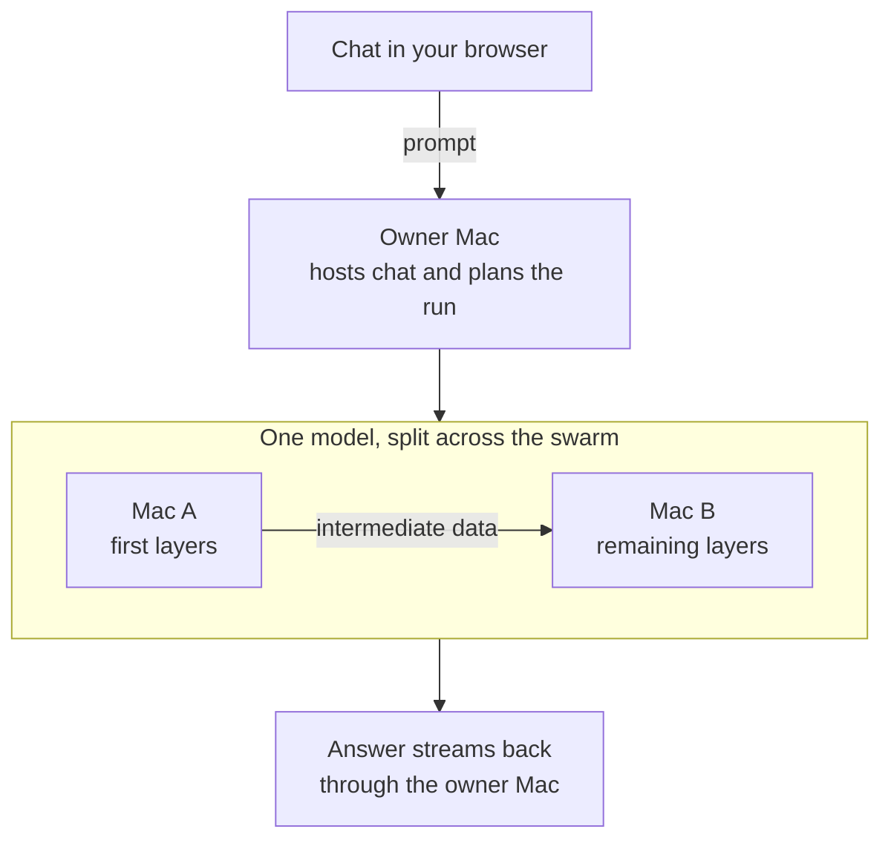

# Mycelium

Mycelium lets Apple silicon Macs share the work of running one language model. It splits the model's layers across a **swarm**: the owner's Mac hosts the chat, and each participating Mac computes its part of the answer.

It is for people who want to run models with Macs they own or with people they trust. Sharing the work can help when a model does not fit in one Mac's memory. It does not make a slow network fast, and it does not hide your prompts from the computers doing the work.

[Try the demo in your browser](https://mycelium.now/swarms/) · [Download v0.1.3](https://github.com/Tranquil-Flow/mycelium/releases/tag/v0.1.3) · [Set up two Macs](#setting-up) · [Privacy and trust](#privacy-and-trust) · [Report a problem](https://github.com/Tranquil-Flow/mycelium/issues)

<!-- Product screenshots are a follow-up. Add reviewed captures of onboarding and a serving chat here. -->

## Status

**v0.1.3 is an early macOS preview, not a broadly tested release.** It improves retries after brief connection failures on joined Macs. Read the [v0.1.3 release notes](docs/RELEASE-NOTES-v0.1.3.md) for the changes and upgrade instructions.

- Apple silicon Macs only. Intel Macs, Windows and Linux are not supported by this release.
- The app has an ad-hoc Apple signature. It is not Developer ID signed or notarized. macOS approval of the installer may need an administrator.
- A two-Mac swarm, with both Macs owned by the developer, started from the app and completed chats over a phone hotspot. That run used **Qwen2.5-0.5B and fast mode**. Fast mode in v0.1.3 stops answering about five minutes after a route starts serving (see [Optional fast mode](#optional-fast-mode)), so the public demo runs in normal mode.
- Nobody outside the developer has yet completed a self-hosted swarm. Wider testing is wanted, particularly installation and a first chat on other people's Macs.

### Performance observed so far

A token is a small piece of text, not necessarily a whole word. Decode speed measures how quickly those pieces arrive after the first one.

| Mode | Observed result | Limits of the observation |
| --- | --- | --- |
| Fast mode, Qwen2.5-0.5B | About 12.5–15.6 tokens/s; first token in about 4–7 seconds | Two developer-owned Macs on a phone hotspot, measured in the first minutes of serving. In v0.1.3 fast mode stops answering about five minutes after the route starts. It is off by default and cannot recover an in-flight request after a stage fails. |
| Normal mode, fast mode off | About 1.1 tokens/s; first token in about 3–5 seconds; a 27-token answer in about 32 seconds | The live public demo on two developer-owned Macs over a phone hotspot, still answering 12 minutes after the route started. This is the default recovery-capable path. Recovery still needs a suitable ready replacement. |
| Larger models, including the default Qwen3-14B | Speed not tested | The small-model result is not a prediction for them. |

These are observations, not guarantees. More Macs do not necessarily mean faster answers: data must pass between them for every generated token.

## How it works



- A **model** is the downloaded set of weights used to generate text. Its **layers** are successive calculation steps. Mycelium divides those steps between Macs rather than asking every Mac to generate a separate answer.
- The **owner** creates the swarm, approves members, chooses the model and starts the run. The owner Mac also contributes computation in the two-Mac app flow.
- A **joined Mac** accepts bounded work from that owner. It runs its assigned layers with MLX, Apple's machine-learning library, and passes intermediate numbers, called activations, to the next stage.
- A **route** is the ordered set of stages that runs the model. The app checks the route before it serves chat. A Mac being joined or having downloaded files does not mean the route is ready.
- The owner downloads the full model source. For Qwen3-8B and Qwen3-14B, joined Macs fetch only their assigned slices. Small models such as Qwen3-0.6B use a whole source snapshot on each Mac, although computation is still split.

For example, Rowan and Kit each have a Mac. Rowan creates a swarm and sends Kit a join link. Kit chooses resource limits and agrees to accept Rowan's work; Rowan checks Kit's fingerprint and approves. When Rowan starts the model, the app divides its layers between the two Macs. Kit is contributing computation, not just opening a second chat window. If Kit leaves, that route may stop being able to answer.

This is inference: running an existing model. It is not training a new model or merging the Macs into one general-purpose computer. If your model already runs comfortably on one Mac, you may not need a distributed setup.

## Swarms, identities and relays

### Who controls a swarm

The app creates local signing keys to identify the swarm owner and each member. A signature lets a Mac check who authorized a message; it does not make the person behind that key trustworthy. A **fingerprint** is a short identifier you can compare with the other person before approval. You do not need an email address or a Mycelium account.

A join code admits one Mac and expires. Prefer the full join link: it includes the relay address and a digest identifying the owner's key. Send it privately to the intended person, compare fingerprints, then approve that Mac.

**Standing consent** means a joined Mac automatically accepts this owner's work while the app is open, within the storage, memory, time, power and network limits its user chose. It also sends capability and link reports to the owner, including chip, memory, free disk, power and thermal state. Consent is not permission for unlimited work. You can withdraw it or leave the swarm.

Keep your app data if you want to keep your identity. Do not copy a private key or state folder to another Mac to make it a member; invite that Mac separately.

### Two different kinds of relay

The normal app setup needs internet access, even when both Macs share a Wi-Fi network.

| Component | What it does | Do you need to set it up? |
| --- | --- | --- |
| Owner's public HTTPS relay | Makes the owner's join, control and web-chat endpoints reachable. The default is a temporary Cloudflare tunnel. | Press **Start public relay**, or tick **Let other Macs join** when creating the swarm. No domain or Cloudflare account is needed for the temporary tunnel. |
| Iroh transport | Carries inference data between Macs over encrypted connections, directly where possible or through n0's relay service. | The app uses it for you. It is separate from the web-chat tunnel. |
| Public swarm directory | Lists swarms so other people can find them and request chat access. It does not supply computing power. | Optional. You do not need a listing to run with an invited Mac. |

Starting the public relay does not publish a directory listing. It still exposes endpoints through a third party. The temporary address changes on restart, and its session expires after at most 30 minutes. Do not treat it as a permanent hosting service.

## Privacy and trust

**Only join or invite Macs whose owners you trust. Do not use this preview for secrets.**

| Party | What it can see |
| --- | --- |
| Owner Mac | Prompts sent to its chat and the answers it returns. |
| Assigned swarm members | Prompts, outputs or intermediate data needed for their work, plus sizes and timing. Splitting layers is not confidential inference from those members. |
| Cloudflare, when you use the default tunnel | Join/control traffic, visitor addresses and timing, and web-chat prompts and replies that cross the tunnel. Cloudflare terminates HTTPS, so it can see that content in plaintext. |
| A front end serving your own relay address | The same web/control traffic passing through it. Owning the hostname does not remove this trust requirement. |
| Iroh's n0 relays and name service | Connection metadata; relayed inference traffic is encrypted between the participating Macs by Iroh. This does not hide the data from those Macs. |
| Hugging Face | Model/file requests and the requesting Mac's address when it downloads from there. A member may fetch from the owner instead; across networks, Hugging Face can be preferred over the owner's tunnel. |
| Public directory, if you publish | Public listing metadata, keys/fingerprints, entry address, model, member count and access-request notes. Chat requests go from the visitor's browser to the swarm entry, not through the directory API. |

The recovery path can write unencrypted prompt and partial-answer data to the local state directory. Startup cleanup handles crash leftovers, but backups may retain copies. Local storage and encrypted transport are not a promise that no copy of a conversation exists.

There is no supported, fully offline two-Mac app flow in v0.1.3. The source includes offline model-transfer and local-network work, but those pieces are not an end-to-end offline inference setup. See [local-first scope](docs/LOCAL-FIRST.md). The older [privacy guide](docs/user/PRIVACY.md) has more background; its statements that the hosted demo is deliberately off and that some code is unmerged predate this release.

## What you need

- **Two separate Apple silicon Macs**, running the same app version. Two app instances on one Mac do not count. Use the same Wi-Fi for a first test; the tested setup used a phone hotspot. Cross-network friend swarms have source/test coverage, but not a completed physical run across two different networks.
- **Enough memory and free storage on each Mac.** The app checks the chosen model and split against both hardware capacity and your consent limits. The owner needs room for the full source download plus preparation files, not just its running slice.
- **Internet access** for model acquisition and the app's relay/transport services. A metered hotspot can incur substantial downloads.
- **Power and awake Macs.** Defaults allow AC power and unmetered networks only. Keep the owner and joined Macs awake with the app open. Allow incoming connections for Mycelium's components if macOS asks, and enable automatic date and time on both Macs.

### Choose a model before a large download

The owner's **Model** picker, under **Run the model across the joined Macs**, offers these pinned versions:

| Model | Approximate source download on the owner | Use |
| --- | --- | --- |
| Qwen3-0.6B | 1.5 GB | Smallest GUI choice; use it for an initial setup test. Each Mac receives the source snapshot. |
| Qwen3-8B | 16.4 GB | Larger model; joined Macs receive assigned slices. Speed is not established here. |
| Qwen3-14B | 29.6 GB, roughly 30 GB | Default for a fresh app state; joined Macs receive assigned slices. Speed is not established here. |

These are download sizes, not total disk or memory requirements. Read the app's per-model storage requirement before consenting. The Qwen2.5-0.5B used for the measured run is an operator-selected model, not a choice in this GUI picker. That benchmark does not measure Qwen3-0.6B.

## Setting up

### Install on both Macs

1. Download `mycelium-0.1.3-macos-arm64.zip` and its `.sha256` file from the [v0.1.3 release](https://github.com/Tranquil-Flow/mycelium/releases/tag/v0.1.3).
2. In Terminal, run the command below and compare the result with the release checksum. If they differ, do not install.

   ```sh
   shasum -a 256 ~/Downloads/mycelium-0.1.3-macos-arm64.zip
   ```

3. Extract the archive. Follow the [macOS quickstart](docs/user/QUICKSTART-MACOS.md#step-2-unzip-and-check-the-signature) to check the app signature, then run **Install Mycelium.command** from the extracted folder. Do not start the app inside that folder directly.
4. If macOS blocks the installer, use **System Settings → Privacy & Security → Open Anyway** for that installer after checking the download. A standard user may need an administrator to approve it. **Do not disable Gatekeeper.** If approval still fails, stop and report the exact message.
5. Wait for `Mycelium is installed for this user`. Open `~/Applications/Mycelium A13.app`. It opens the local control page in your browser; choose **Open private demo** if prompted.

The installer checks package hashes and a signed manifest before installing into your user folders. An ad-hoc signature and a matching checksum do not establish that software is safe. See the [full installation guide](docs/user/QUICKSTART-MACOS.md) for checks, rollback and uninstall.

### First run: owner and joined Mac

Choose storage and network allowances **before creating or joining**. For the small GUI model, a 4 GB storage allowance is a practical starting choice; the app still checks the exact preparation and memory needs. If you intend to use a larger model, select its larger displayed storage allowance instead. In v0.1.3, editing a visible selector later does not replace the saved enrollment policy. If an existing policy blocks you, use a smaller model or report the refusal rather than deleting identity files.

| Step | Where | What to do |
| --- | --- | --- |
| 1. Consent | Both Macs | Read the cooperative-peer visibility warning and tick its box. Set **Power policy**, **Network policy** and **Storage limit**. On a hotspot, explicitly allow **Metered use allowed** if you accept the data cost. |
| 2. Create | Owner Mac | Press **Create authority & enroll this Mac**. You can tick **Let other Macs join** to start the temporary relay too, or leave that until step 4. |
| 3. Prepare | Owner Mac | Choose **Qwen3-0.6B (tests, quick bring-up)** in **Model** for a small first test. Under **Inference**, authorize the source fetch, check **Maximum bytes to fetch this attempt**, press **Download / resume source**, and wait for `prepared`. This does not start inference. |
| 4. Invite | Owner Mac | Press **Start public relay** if it is not running. Choose **Code lifetime**, then **Invite a Mac**. Send the full join link to the other person privately. Starting the relay after the download avoids using up its session while waiting. |
| 5. Join | Second Mac | Paste the link into **Join code or link**. Choose **Memory limit per run** and **Time limit per run**, read and tick the standing-consent box, then press **Join with code**. You do not need the older manual pairing form. |
| 6. Approve | Owner Mac | Compare the fingerprint with the person joining and review the Mac's report. Press **Approve this Mac**. |
| 7. Start | Owner Mac | In **Run the model across the joined Macs**, press **Start demo**. Wait while the Macs report in, prepare files, load their stages and qualify the route. Compilation can take several minutes on a busy owner Mac. |
| 8. Chat | Owner Mac | Once the run says **Serving**, choose **Open the chat on this Mac**. Send a short prompt. The answer streams, and **Served by:** identifies the participating nodes. |

Keep both apps open. A joined Mac accepts runs within its standing consent without repeated clicks. After restarting its app, press **Start / reconnect**. If it restarted during a run, the owner must start a fresh run; reconnecting does not restore the old in-flight request.

For an upgrade, stop serving and quit on every participating Mac, install the same new version on all of them, retain app data, then reconnect and build a fresh route. Do not upgrade an in-flight route or assume mixed versions work.

## What you can do

### Chat and manage a run

- Send text prompts and watch answers stream. The room chat accepts one prompt at a time, limits prompts to 2,000 characters and offers **Max new tokens** to bound the answer length.
- See the run's steps, members, layer assignments and resource limits. Joining and serving have separate states.
- Use **Stop** in the run card to stop the run, or **Rebuild with current members** when the participating Macs change.
- Use **Cancel download & retain partials** to interrupt acquisition, then **Download / resume source** to retry with retained files verified.

### Resource settings

- **Power policy:** allow AC-only operation or permit battery use.
- **Network policy:** allow only unmetered networks or permit metered use.
- **Storage limit:** cap the storage authorized at enrollment. It must cover the model's preparation needs.
- **Memory limit per run:** cap the joined Mac's memory allowance. Choices depend on that Mac's memory.
- **Time limit per run:** bound work accepted under standing consent. The demo run also has its own 30-minute execution ceiling.
- **Adaptive sharing:** when enabled, use coarse memory, CPU, heat and battery observations to reduce or pause work under pressure. It is enabled by default when you consent. It does not inspect which apps you run.
- **Pause sharing:** manually stop taking new work and free model memory after current work is resolved. It works whether Adaptive sharing is on or off. Resuming waits for a calm period and fresh readiness checks.

Turning Adaptive sharing off does not remove your memory, disk, power, heat or network limits. Pausing a Mac can interrupt service; it is not a guarantee that another Mac will finish every answer.

### Stop, reconnect or leave

| What you want | Control | Effect |
| --- | --- | --- |
| Stop this Mac's serving work | **Stop serving now** | Stops new work and begins withdrawal. **Allow serving again** permits re-entry after checks. |
| Pause membership but retain identity | **Stop & retain private state** | Stops membership activity; **Start / reconnect** resumes it. |
| End automatic acceptance | **Withdraw standing consent** | Stops automatic work acceptance and running work; retains membership. |
| Leave as a joined Mac | **Leave smoothly** or **Instant leave**, after confirmation | Withdraws consent and stops renewing membership. Smooth leave waits for current work within a bounded timeout; instant leave disconnects now. Files and identity remain. |
| Revoke a member as owner | **Revoke member** in the member list | Prevents future work under that membership. This is not deletion of that Mac's local files. |
| Close Mycelium | **Quit launcher** | Exits the app. Use it when finished, not just the browser's close button. |

Leaving is different from pausing. A Mac that left may need the owner to revoke its old membership and send a fresh join code before it can return. [Troubleshooting](docs/user/TROUBLESHOOTING.md#a-mac-that-left-the-swarm-or-was-restarted-while-serving) covers this case. Uninstall keeps identity and state unless you explicitly request their deletion; see [How to stop](docs/user/QUICKSTART-MACOS.md#how-to-stop).

### Publish a swarm or use someone else's

The optional [public directory](https://mycelium.now/swarms) lets people find a swarm and chat from a browser without contributing a Mac. The developer's own two-Mac swarm is listed there as **Mycelium demo** while it runs; it can be intermittent. A listing does not guarantee that a swarm is currently serving or that its operator is trustworthy.

On the owner page, use **Publish this run as a swarm**, enter a name and description, and choose **Access**:

- **Request access (you approve here):** review requests and press **Approve** or **Decline**. Set **Grant lifetime (hours)** and the request/answer quotas.
- **Open (automatic, quota per key):** visitors receive bounded access without individual approval.
- **Invite only:** access needs an owner-issued grant. This does not hide the listing.

All published listings are public. The owner Mac checks access before forwarding prompts to the swarm. **Stop publishing** stops the entry's publication; tick **also delete the listing** to remove the directory record too.

On the website, a browser key replaces an account. The browser creates and retains the private key; owners grant access to its fingerprint. Clearing site data or pressing **Forget this key (and its grants and swarms)** loses access and management rights held by that key. A stable key can link your activity across swarms; it is not anonymity.

You can also create a listing on the website, then paste its swarm link into the app and choose **Offer this Mac as the swarm's entry**. Attach that Mac from the browser that created the listing. This registers an entry; it does not start the model. For a first two-Mac test, skip publication and use the owner app flow above.

## Known limitations and troubleshooting

| Symptom | What to check |
| --- | --- |
| `owner_model_not_prepared` | Authorize and finish **Download / resume source** on the owner before starting. |
| `relay_required` | Press **Start public relay**. It can start before or after swarm creation. |
| Expired link or `pairing_window_origin_stale` | The temporary relay may have expired or changed address. Ask for a new invitation link. |
| Joined Mac does not return after an app restart | Press **Start / reconnect** there, then start a new run on the owner. |
| Route compilation takes minutes | Keep the owner awake and give it time. If a step fails, record the step and error code. |
| Memory, disk or consent-limit refusal | Check free resources and the model's displayed requirement. Choose a smaller model if it does not fit; moving a selector does not rewrite saved consent. |
| `member_work_not_running` | Check that every Mac is on v0.1.3, awake, connected and consented. This release retries brief control failures; sustained failures still stop the run. |
| `peer_clock_skew_exceeded` | Turn on automatic date and time on both Macs. |
| An answer ends with a failure | Restore the missing member or route and send a new request. Do not assume an interrupted answer completed. |

Only two-Mac swarms have been exercised end to end in the release testing described here. Larger swarms, larger-model performance and wider hardware compatibility remain unproven. Experimental Windows/Linux packages in the source tree are not supported releases. A membership-only or browser test is not proof of distributed inference.

### Optional fast mode

Fast mode is **off by default** and has no GUI switch. It requires `MYCELIUM_TOKEN_PATH=on` in the owner/application process's launch environment before the app starts and a fresh route is created. Leave it unset or set it to `off` for the normal recovery-capable path. Setting a variable in an unrelated Terminal window does not change an already running app.

**Known issue in v0.1.3: leave fast mode off.** About five minutes after a route starts serving, every fast-mode request fails with `backend_failed`. The fast path's permission is tied to a short membership lease that is not renewed while the route serves. A fix is planned for the next release.

Stop serving and restart the owner/application before changing modes. Fast mode has no mid-request failover, replay recovery or continuation from saved model working memory. If a stage fails, a request can fail; starting another request is not recovery of that one. See the [fast-mode instructions and limits](docs/RELEASE-NOTES-v0.1.2.md#fast-mode-opt-in-and-limits).

### Reporting problems and next tests

[Open an issue](https://github.com/Tranquil-Flow/mycelium/issues) with the app version, macOS version, Mac chip and memory, model, network type, fast-mode setting, failed step and short error code. Say whether the failure was during installation, joining, download or chat. Remove prompts, join links, credentials, private keys, addresses and personal paths from any log or screenshot before sharing it.

The immediate need is independent two-Mac testing, including people on different networks. Product screenshots are also a follow-up. There is no promised date here for broader platform support, notarization or a fully offline swarm.

## Running the server parts

For the normal two-Mac flow, the owner app starts the membership service, relay connection and chat entry. You do not need to install a separate Mycelium server, run SSH or copy invitation files manually. You do need to keep the owner app and its relay running.

**Use my own address** is optional for operators who want a fixed hostname. Configure a public HTTPS front, such as a named Cloudflare tunnel or reverse proxy, to forward to an unused local port on the owner Mac. Then enter the HTTPS hostname and that port in the app and press **Start relay on my address**. Tick the Cloudflare checkbox only when that front is a Cloudflare tunnel. Mycelium does not create DNS records, obtain certificates or configure the front for you. Send full join links; typed short codes work only with temporary tunnel names. See [fixed-address setup](docs/user/QUICKSTART-MACOS.md#use-your-own-address-advanced-optional).

The directory is a separate optional service in [`mycelium_swarm_directory/`](mycelium_swarm_directory/). Its [server](mycelium_swarm_directory/server.py) serves listing/access APIs and the website, not model computation. Operators hosting it need their own HTTPS front and persistent state. Neither hosting a directory nor giving the owner a stable address removes the participating Macs' trust requirements.

## Build from source

Use the release package unless you want to develop Mycelium. The app build targets Apple silicon macOS and uses Python 3.14. From the repository root, create an isolated environment:

```sh
env -u PYTHONPATH python3.14 -m venv .venv
env -u PYTHONPATH .venv/bin/python -m pip install \
  cryptography numpy pytest pytest-asyncio -r requirements-dev.txt
env -u PYTHONPATH .venv/bin/python -m pip install \
  -r requirements-a13-macos-runtime.txt
```

The [runtime requirements](requirements-a13-macos-runtime.txt) pin the MLX and MLX Metal wheels used for the macOS target. Do not substitute wheels selected only for a newer build machine's OS. Test dependencies and the packaged app are separate.

### Developer setup and checks

A small test target:

```sh
env -u PYTHONPATH .venv/bin/python -m pytest -q -p no:cacheprovider tests/invite
```

See [`pytest.ini`](pytest.ini) for test levels and markers. Physical tests require real hardware and explicit setup; do not run all tests expecting a hardware-free suite. Browser tests also need the browser binaries matching the pinned Playwright version, not just the Python package.

The separate research web interface has its own checks:

```sh
cd ui/web
npm ci
npm run check
```

It is not the browser page bundled with the macOS app. The [browser-swarm guide](docs/interactive-browser-swarm.md) describes a separate local qualification tool, not the two-Mac app setup.

### Package the macOS app

Return to the repository root after the web-interface checks. [`scripts/build_a13_macos.py`](scripts/build_a13_macos.py) builds an ad-hoc-signed app in a **new, non-existing output directory**. Besides the Python environment, it requires PyInstaller, Apple's command-line build tools, Rust/Cargo, the locked native dependencies cached for an offline build, `cloudflared` on `PATH` with its license at `.build-native/cloudflared-LICENSE`, and Homebrew Expat. Read the script's dependency checks before building.

```sh
env -u PYTHONPATH .venv/bin/python scripts/build_a13_macos.py \
  --output-root dist/readme-local-build
```

This is not yet an installable release archive. [`scripts/finalize_a13_macos.py`](scripts/finalize_a13_macos.py) adds the install source, signed package manifest, installer and checksums. That separate packaging step requires an explicitly supplied signing-key file. Do not reuse the project's release identity or describe a local build as an official release. Building does not notarize the app.

## Repository layout

| Path | Purpose |
| --- | --- |
| [`mycelium_a13_macos/`](mycelium_a13_macos/) | Shipped macOS app, local browser UI, consent, joining and run control. |
| [`mycelium_layer_planner/`](mycelium_layer_planner/), [`mycelium_router/`](mycelium_router/) | Layer placement and request routing. |
| [`mycelium_live/`](mycelium_live/), [`mycelium_node/`](mycelium_node/) | Serving routes and native workers. |
| [`native/iroh_transport/`](native/iroh_transport/) | Native transport helper for connections between Macs. |
| [`mycelium_seed/`](mycelium_seed/), [`mycelium_invite/`](mycelium_invite/), [`mycelium_membership/`](mycelium_membership/) | Swarm authority, invitations and membership. |
| [`mycelium_swarm_directory/`](mycelium_swarm_directory/) | Optional public directory and browser chat/access UI. |
| [`ui/web/`](ui/web/) | Separate research and operator interface. |
| [`scripts/`](scripts/), [`tests/`](tests/), [`docs/`](docs/) | Build and verification tools, tests and documentation. |

## Documentation index

| Guide | Scope |
| --- | --- |
| [v0.1.3 release notes](docs/RELEASE-NOTES-v0.1.3.md) | Current fixes, verified run, limits and upgrade steps. |
| [macOS quickstart](docs/user/QUICKSTART-MACOS.md) | Detailed install checks, first run, fixed address and uninstall. |
| [Troubleshooting](docs/user/TROUBLESHOOTING.md) | More error codes and remedies. Its old relay-order restriction is superseded by this README. |
| [User guides](docs/user/README.md) | Feature and privacy background; some test verdicts and deployment status describe earlier candidates. |
| [Friend swarms](docs/FRIEND-SWARM.md) | Cross-network behavior, relay setup and trust boundaries; physical cross-network testing remains open. |
| [Local-first scope](docs/LOCAL-FIRST.md) | Offline transfer and LAN work, with explicit end-to-end limitations. |
| [Native multi-device onboarding](docs/swarm-multi-device-onboarding.md) | Advanced membership-only operator runbook, not the current app join flow. |
| [Layer planner](LAYER_PLANNER_PRODUCT_V1.md), [router design](REQUEST_AND_INTER_LAYER_ROUTER_DESIGN.md) | Technical architecture. Design documents are not release guarantees. |

## Licence

Mycelium is licensed under the GNU Affero General Public License, version 3 only (`AGPL-3.0-only`). See [`LICENSE`](LICENSE). Downloaded models and bundled third-party components have their own licenses.
